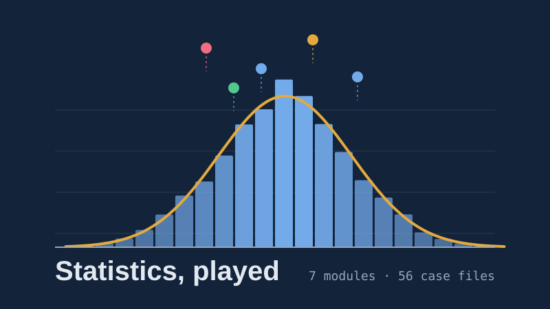
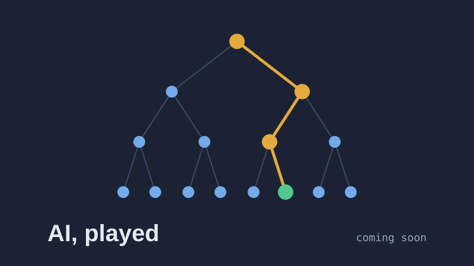

```{=html}
<style>
.play-grid{display:grid;grid-template-columns:repeat(auto-fill,minmax(300px,1fr));gap:22px;margin:8px 0 34px}
.play-card{display:flex;flex-direction:column;border:1px solid rgba(127,127,127,.3);border-radius:12px;overflow:hidden;text-decoration:none!important;color:inherit!important;transition:transform .15s,box-shadow .15s;background:var(--bs-body-bg,#fff)}
.play-card:hover{transform:translateY(-3px);box-shadow:0 10px 28px rgba(0,0,0,.14)}
.play-card img{display:block;width:100%;aspect-ratio:16/9;object-fit:cover}
.play-card .pc-body{padding:16px 18px 18px;display:flex;flex-direction:column;gap:6px;flex:1}
.play-card h3{margin:0;font-size:1.3rem}
.play-card p{margin:0;font-size:.95rem;opacity:.85}
.play-card .pc-meta{margin-top:auto;padding-top:10px;display:flex;flex-wrap:wrap;gap:6px}
.play-card .pc-meta span{font-size:.78rem;border:1px solid rgba(127,127,127,.35);border-radius:999px;padding:2px 10px}
.play-card.soon{pointer-events:none;opacity:.6}
.play-card .pc-go{font-weight:600;color:var(--bs-link-color,#1F5FA8)}
.play-how{display:grid;grid-template-columns:repeat(auto-fit,minmax(220px,1fr));gap:16px;margin:10px 0 24px}
.play-how div{border-left:3px solid #A86E06;padding:4px 0 4px 14px}
.play-how b{display:block;margin-bottom:2px}
</style>

<div class="play-grid">
  <a class="play-card" href="play/stats/">
    
    <div class="pc-body">
      <h3>Statistics, played</h3>
      <p>From describing data to probability, distributions, inference, regression, trees and clustering, through six fictional organisations and their real problems.</p>
      <div class="pc-meta"><span>7 modules</span><span>56 case files</span><span>about 380 questions</span><span>graduate level</span></div>
      <span class="pc-go">Start playing →</span>
    </div>
  </a>
  <div class="play-card soon" aria-disabled="true">
    
    <div class="pc-body">
      <h3>AI, played</h3>
      <p>Search, heuristics, constraint satisfaction and reasoning, with algorithms you can watch think.</p>
      <div class="pc-meta"><span>coming soon</span></div>
    </div>
  </div>
</div>

<div class="play-how">
  <div><b>One story per module</b>A company or village with a problem; the statistics is what solves it.</div>
  <div><b>Theory, briefly</b>Short explanations with the equations and pointers to standard textbooks.</div>
  <div><b>Labs that move</b>Simulations that run unit by unit, with play, speed and reset.</div>
  <div><b>XP and badges</b>First-try answers earn full XP; five cleared files unlock the board meeting.</div>
</div>

<p style="font-size:.9rem;opacity:.75">Free to use in teaching. No sign-in; progress is saved in your own browser. All organisations, people and data sets are fictional.</p>
```
